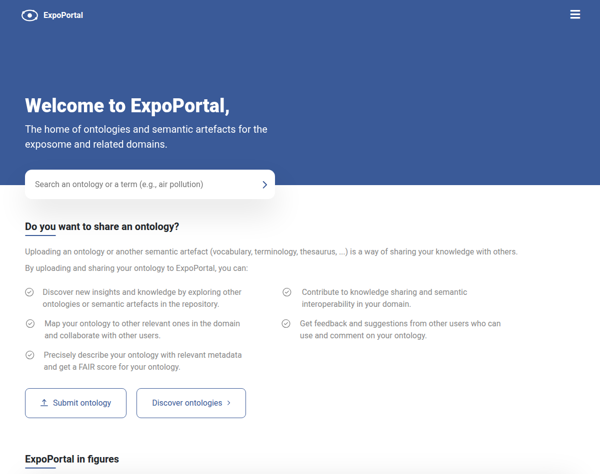

# ExpoPortal (OntoPortal)

<!--- This file is autogenerated. Edit expoportal.json to make changes in this page. ---> 

An OntoPortal ontology repository for exposome-relevant ontologies, set up at BioHackathon Europe 2026 (project 19). Browse and search ontologies, annotate text, explore mappings between ontologies and check FAIR scores (O'FAIRe). Programmatic access through the OntoPortal REST API (free account API key) and a read-only MCP server for LLM agents at https://expoportal.biohackeu.bigcat-bioinformatics.org/mcp.

**Main Webpage:** [https://expoportal.biohackeu.bigcat-bioinformatics.org/](https://expoportal.biohackeu.bigcat-bioinformatics.org/)

**Tool Webpage:** [https://expoportal.biohackeu.bigcat-bioinformatics.org/](https://expoportal.biohackeu.bigcat-bioinformatics.org/)

## Contact

**Contact Person(s):** Marvin Martens (marvin.martens@maastrichtuniversity.nl), Egon Willighagen (egon.willighagen@maastrichtuniversity.nl)

**Provider Institute:** [Department of Translational Genomics, Maastricht University](https://www.maastrichtuniversity.nl/research/translational-genomics)

## Documentation

#### VHP4Safety Documentation

* Service Introduction: To be added

* Workflow: To be added

* Demo: To be added

<h4 id='tess-widget-materials-header'></h4>

## VHP4Safety Service Metadata

* Stage: https://vhp4safety.github.io/glossary#VHP0000154

* Sub-Stage: https://vhp4safety.github.io/glossary#VHP0000047

* Development Cloud: [https://expoportal.biohackeu.bigcat-bioinformatics.org/](https://expoportal.biohackeu.bigcat-bioinformatics.org/) 

* Login Required: REST API: API key; MCP: no

* TRL: Not available

* Type: internal

* API Type: REST API (OntoPortal API, free account API key); MCP server (read-only, no login)

* Categories: To be added

* Targeted Users: To be added

* Relevant VHP4Safety Use Case: To be added

## Technical Tool Specifications

* Citation: [10.1093/nar/gkp440](https://doi.org/10.1093/nar/gkp440)

* Version: AgroPortal OntoPortal images (master, November 2026)

* License: BSD-2-Clause

* Source Code: [https://github.com/agroportal/ontoportal_docker](https://github.com/agroportal/ontoportal_docker)

* Docker: [https://hub.docker.com/u/agroportal](https://hub.docker.com/u/agroportal)

* Bio.tools: Not available

* FAIRsharing: Not available

* TeSS: [OntoPortal](OntoPortal)

* RSD: Not available

* Wikipedia: Not available

