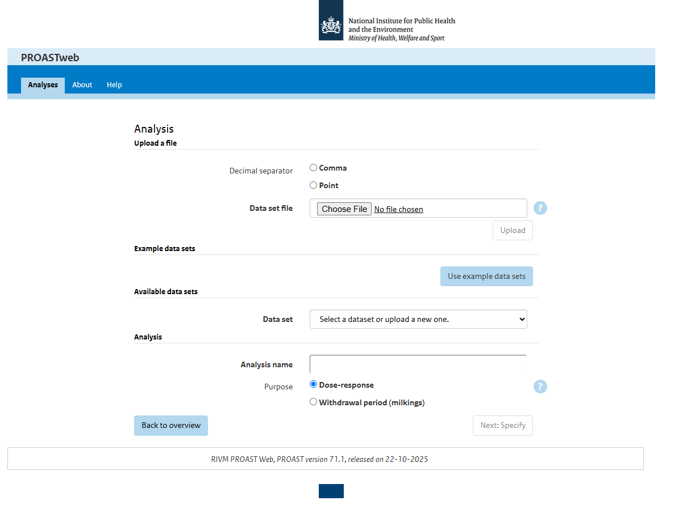

# PROAST

<!--- This file is autogenerated. Edit proast.json to make changes in this page. ---> 

PROAST is a software package for the statistical analysis of dose-response data. Its main purpose is dose-response modelling of 			toxicological data, and the derivation of a Benchmark dose (BMDL) in human risk assessment (or an ECx in ecotoxicological risk assessment). 		More generally, it can be used for (nonlinear) regression (with covariates). It can be run as webapplication or be installed on your own 		machine using R.

**Main Webpage:** [https://www.rivm.nl/en/proast](https://www.rivm.nl/en/proast)

## Contact

**Contact Person(s):** RIVM Team (proast@rivm.nl)

**Provider Institute:** [National Institute for Public Health and the Environment (RIVM)](https://www.rivm.nl/)

## Documentation

#### VHP4Safety Documentation

* Service Introduction: To be added

* Workflow: To be added

* Demo: To be added

<h4 id='tess-widget-materials-header'></h4>

## VHP4Safety Service Metadata

* Stage: Other

* Sub-Stage: 

* Development Cloud: Not available

* Login Required: No

* TRL: Not available

* Type: external

* API Type: 

* Categories: To be added

* Targeted Users: To be added

* Relevant VHP4Safety Use Case: To be added

## Technical Tool Specifications

* Citation: 

* Version: 71.1

* License: 

* Source Code: [https://www.rivm.nl/documenten/proast700](https://www.rivm.nl/documenten/proast700)

* Docker: Not available

* Bio.tools: Not available

* FAIRsharing: Not available

* TeSS: Not available

* RSD: Not available

* Wikipedia: Not available

